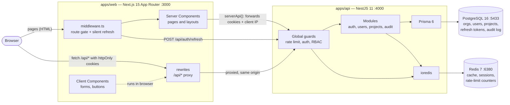
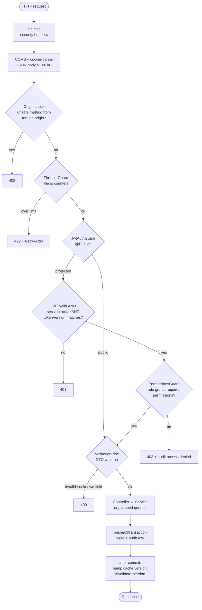
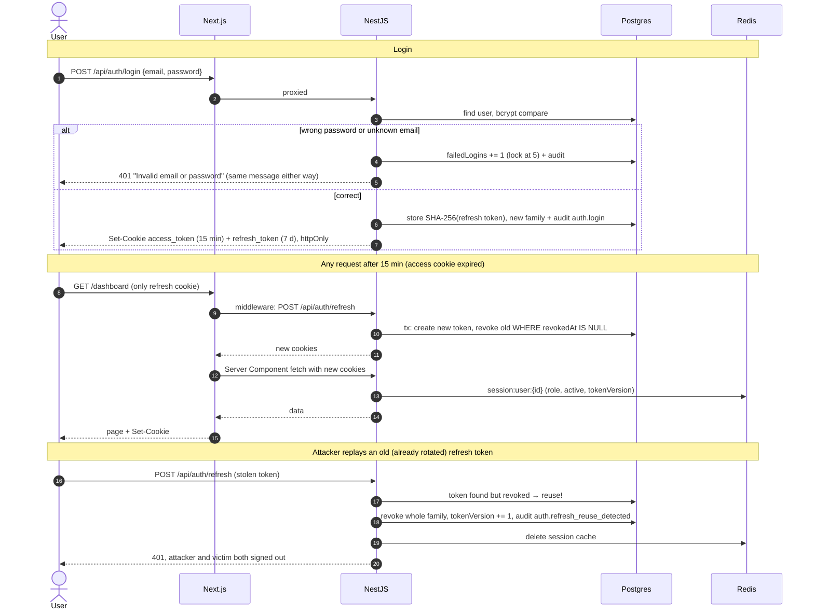
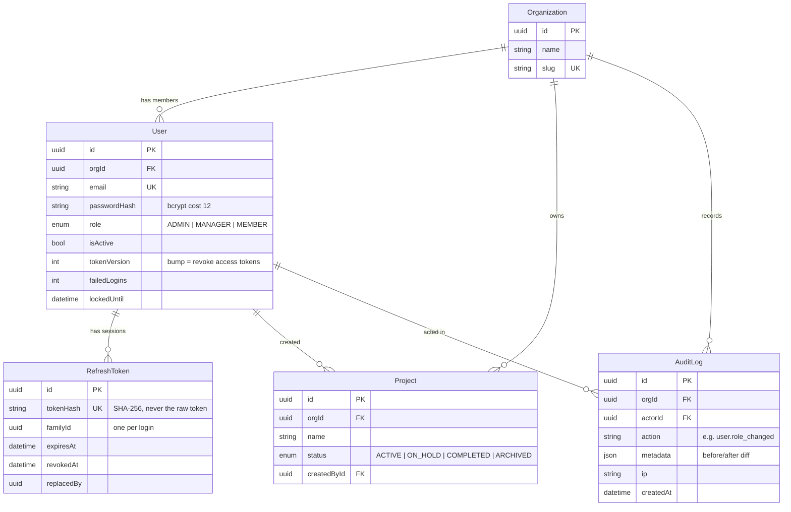
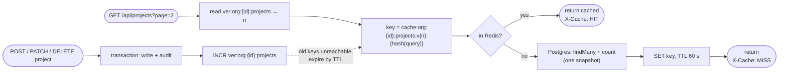

# Architecture

TeamSpace is a multi-tenant SaaS: many organizations share one deployment, and users inside each
organization have one of three roles. This page shows how the pieces fit; the *why* behind each choice
is in the [ADRs](adr/README.md). Project context and scope: [CONTEXT.md](CONTEXT.md).

## 1. System overview



- The browser only ever talks to **:3000**. Next.js proxies `/api/*`, so auth cookies are first-party ([ADR-0002](adr/0002-monorepo-with-next-proxy-to-nest.md)).
- Server Components call the API directly, forwarding the user's cookies and IP ([ADR-0010](adr/0010-app-router-data-fetching-and-route-protection.md)).
- Postgres is the source of truth. Everything in Redis can be rebuilt ([ADR-0007](adr/0007-redis-for-cache-sessions-and-rate-limits.md)).

## 2. API request pipeline

Every request to NestJS passes these layers in order; any layer can stop it.



Code: [main.ts](../apps/api/src/main.ts), [app.module.ts](../apps/api/src/app.module.ts), [guards.ts](../apps/api/src/common/guards.ts).

## 3. Authentication flows

Login, silent refresh and stolen-token detection ([ADR-0003](adr/0003-cookie-sessions-with-rotating-refresh-tokens.md)).



## 4. Data model



Every tenant-owned table carries `orgId`, and every query filters by the `orgId` from the session, never
from the request ([ADR-0005](adr/0005-shared-schema-multi-tenancy.md)). Schema: [schema.prisma](../apps/api/prisma/schema.prisma).

## 5. Roles and permissions

| Permission | ADMIN | MANAGER | MEMBER | Used by |
|---|:-:|:-:|:-:|---|
| `project:read` | ✓ | ✓ | ✓ | Dashboard, project list |
| `project:write` | ✓ | ✓ | | Create / edit project |
| `project:delete` | ✓ | | | Delete project |
| `user:read` | ✓ | ✓ | | List team members (API) |
| `user:manage` | ✓ | | | Invite, change role, deactivate; admin area |
| `audit:read` | ✓ | | | Audit log |

Single source of truth: [rbac.ts](../apps/api/src/common/rbac.ts). The role is re-read from the Redis
session cache on each request, so changes apply immediately ([ADR-0004](adr/0004-permission-based-rbac.md)).
Rule enforced in a Serializable transaction: an organization always keeps at least one active admin
([ADR-0006](adr/0006-transactions-and-append-only-audit-log.md)).

## 6. Caching



| What | Redis key | TTL | Invalidated by |
|---|---|---|---|
| Project list pages | `cache:org:{id}:projects:v{n}:{hash}` | 60 s | version bump on any project write |
| Dashboard stats | `cache:org:{id}:projects:v{n}:stats` | 30 s | same version bump |
| User session (role, active, tokenVersion) | `session:user:{id}` | 300 s | role/status change, token reuse |
| Rate-limit counters | `rl:default:{hash}:hits` / `:block` | per limit | expiry |

If Redis is unavailable, cache reads fall through to Postgres. Known gap: the rate limiter does not yet
degrade gracefully ([PROGRESS.md](PROGRESS.md#known-limitations--next-ideas)).

## 7. Security controls

| Threat | Control | Where |
|---|---|---|
| Token theft via XSS | Tokens only in `httpOnly` cookies, never in JSON or `localStorage` | [cookies.ts](../apps/api/src/auth/cookies.ts) |
| CSRF | `SameSite=Lax` + Origin check on unsafe methods | [main.ts](../apps/api/src/main.ts) |
| Stolen refresh token | Rotation on every use, family revoke on reuse, hashed at rest | [auth.service.ts](../apps/api/src/auth/auth.service.ts) |
| Brute force / credential stuffing | 5 logins/min per IP (Redis), lockout after 5 failures | [auth.controller.ts](../apps/api/src/auth/auth.controller.ts) |
| User enumeration | Same error + dummy bcrypt compare for unknown emails | [auth.service.ts](../apps/api/src/auth/auth.service.ts) |
| Privilege escalation | Permission guard on every route; role from server-side session | [guards.ts](../apps/api/src/common/guards.ts) |
| Cross-tenant access | `orgId` from session in every query; foreign ids → 404 | services |
| Mass assignment | DTO whitelist + `forbidNonWhitelisted` | [main.ts](../apps/api/src/main.ts) |
| Instant revocation | `tokenVersion` + `isActive` checked per request | [session.service.ts](../apps/api/src/auth/session.service.ts) |
| Open redirect after login | `safeNext()` allows same-site paths only | [safe-next.ts](../apps/web/src/lib/safe-next.ts) |
| Clickjacking / sniffing | `X-Frame-Options: DENY`, `nosniff`, helmet headers | [next.config.ts](../apps/web/next.config.ts) |
| Weak config | Env validated at boot; JWT secret ≥ 32 chars; `Secure` cookies required in prod | [env.ts](../apps/api/src/config/env.ts) |
| Repudiation | Append-only audit log with actor, IP, user agent, before/after diff | [audit.service.ts](../apps/api/src/audit/audit.service.ts) |

## 8. Repository layout

```
├── apps/
│   ├── api/                 NestJS API
│   │   ├── prisma/          schema, migrations, seed
│   │   └── src/
│   │       ├── auth/        login, refresh rotation, cookies, session cache
│   │       ├── users/       admin flows
│   │       ├── projects/    CRUD, cache, dashboard stats
│   │       ├── audit/       append-only log + cursor pagination
│   │       ├── common/      guards, RBAC, decorators, pagination, filters
│   │       ├── redis/       cache helpers
│   │       └── main.ts      security middleware, global pipes
│   └── web/                 Next.js App Router
│       └── src/
│           ├── app/(auth)/  login, register
│           ├── app/(app)/   dashboard, projects, admin/{users,audit}
│           ├── components/  Sidebar, SessionProvider, Modal, Pagination
│           ├── lib/         api.ts (browser), server-api.ts (server)
│           └── middleware.ts
├── scripts/                 demo.mjs (44 checks), ui-check.mjs (11 checks)
├── docs/                    CONTEXT, PROGRESS, ARCHITECTURE, adr/
└── docker-compose.yml       Postgres + Redis
```
